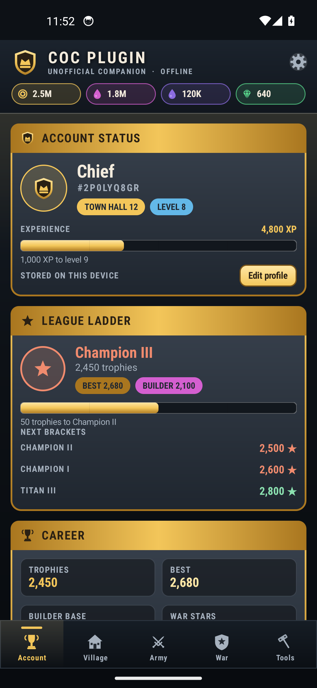
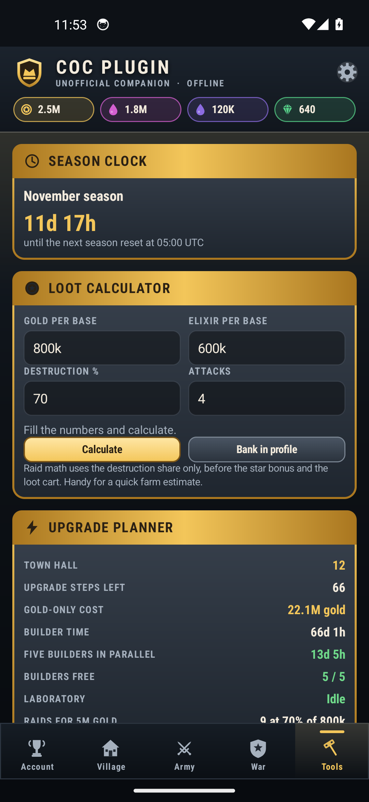

# COCPlugin

**An unofficial Clash of Clans companion that reads your real account from the
official Supercell API.**
Package `plugin.clashofclans`, app name *COCPlugin*.

Enter a player tag and a developer token once: the Account, Army and War tabs
then show the account, clan, current war and unit levels that
`api.clashofclans.com` actually returns. The last reply is cached, so the app
still opens offline, labelled with its age. The Village tab is a local
building planner, because no official endpoint publishes building levels.

It is **not** a mod, a private server client or a bot. It cannot log in, cannot
change an account and cannot attack. It ships no artwork, font or sprite of the
game: every icon and background is an original vector or canvas drawing.

> Clash of Clans is a trademark of Supercell. This project is not affiliated
> with, endorsed by or connected to Supercell.

## Screens

| Tab | Source | What it shows |
| --- | --- | --- |
| **Account** | live | Name, tag, role, Town Hall and experience level, trophies and league, career stats, donation ratio, clan card and the top ten members. |
| **Village** | local planner | Building levels you enter, next-level cost and time, five builder slots, countdowns and totals to max. Clearly marked as a planner. |
| **Army** | live | Every troop, hero, spell and pet with its real level and max level, home village and Builder Base. |
| **War** | live | War state, opponent, countdown to the battle day or the end, stars and destruction for both sides, attacks used and left, and the public war log. |
| **Tools** | local | Season reset clock (first of the month, 05:00 UTC), loot calculator and the planner totals. |

The top bar is the connection itself: it shows `LIVE · api.clashofclans.com`
with the player name and trophies, or `NOT CONNECTED` and a tap target. The
round arrows button forces a sync; the app also syncs on launch when the cache
is older than two minutes.

## Connecting

1. Create an API key at <https://developer.clashofclans.com> (My Account →
   Create New API Key). Copy it.
2. Open the app → tap the status strip → paste the player tag, the token and,
   if you use one, the proxy base URL.
3. **Test** asks the server for the player and prints the real name; **Save and
   sync** stores it and fetches the clan, war and war log.

The token is bound to an IP address. On mobile data that address changes, and
the API answers `403 accessDenied`; `proxy/` contains a Cloudflare Worker and a
small Node server that keep the token server-side. The app accepts any base URL
that answers the same JSON, so a proxy is a one-field change.

Details, endpoints and troubleshooting: [`docs/LIVE.md`](docs/LIVE.md).

## Design

The UI is built from the Android framework: no AndroidX, no Material library,
no third-party runtime dependency. The only permissions are `INTERNET` and
`ACCESS_NETWORK_STATE`.

| Layer | Path |
| --- | --- |
| API models and JSON parser (pure Java, unit-tested) | `app/src/plugin/clashofclans/model` |
| HTTP client and error mapping (pure Java) | `app/src/plugin/clashofclans/net` |
| Connection settings, cache and sync | `app/src/plugin/clashofclans/data` |
| Theme, drawables, canvas icons, widgets | `app/src/plugin/clashofclans/ui` |
| Themed screens | `AccountPanel`, `VillagePanel`, `ArmyPanel`, `WarPanel`, `ToolsPanel` |
| Single activity shell and the five tabs | `MainActivity.java` |

The palette, gold rims, header ribbons, beveled buttons, medallions and the
icon set are generated at runtime (`Skin`, `GlyphView`) or described in
`res/drawable` / `res/mipmap-anydpi-v26`. The launcher icon is an original
shield-and-crown vector.

## Build

Requirements: JDK 17 (or newer), Android SDK with build-tools and a platform
(`android-34` or newer). No Gradle, and the build itself needs no network.

```bash
export ANDROID_HOME=/path/to/android-sdk
bash build.sh
```

The script runs both unit suites, compiles resources with `aapt2`, compiles the
Java sources, dexes with `d8`, aligns with `zipalign`, signs with `apksigner`,
verifies the package name and writes:

```
dist/COCPlugin-2.0.0.apk
dist/COCPlugin-2.0.0.sha256
```

Override the version with `VERSION` and `VERSION_CODE`.

The release key is the committed self-signed keystore
`keystore/coc-plugin.jks` (alias `cocplugin`, password `cocplugin`) so updates
install over each other. Override it with `COC_KEYSTORE`,
`COC_KEYSTORE_PASSWORD`, `COC_KEY_ALIAS` and `COC_KEY_PASSWORD`.

Install on a device or emulator:

```bash
adb install -r dist/COCPlugin-2.0.0.apk
adb shell am start -n plugin.clashofclans/.MainActivity
```

## Tests

```bash
bash tests/run.sh     # 502 model checks + 32 HTTP client checks
bash tests/live.sh    # real HTTPS round trip, token optional
```

- `LogicTest` covers tag normalisation, the XP curve, formatting, upgrade
  costs, league thresholds, loot and war maths, the season clock, the JSON
  parser and the player / clan / war / war-log parsers against recorded
  fixtures.
- `ApiTest` starts a local `HttpServer` and drives the real `CocApi`: URL
  encoding of `#`, the bearer header, gzip replies, 401/403/404/429 mapping,
  the proxy mode without a token and a refused connection.
- `tests/live.sh` calls `api.clashofclans.com` for real. With no token the API
  answers `403 accessDenied`, which still proves DNS, TLS and the client work;
  with `COC_API_TOKEN` and `COC_PLAYER_TAG` it prints the live account.

`docs/ACCEPTANCE.md` records the build and runtime matrix that goes with a
release.

## Screens

| Account | Village | Army | War | Tools |
| --- | --- | --- | --- | --- |
|  |  |  |  |  |

The screenshots above are from 1.0.0 and still show the offline profile. The
2.0.0 rebuild loads the real account; the visual language is unchanged.

## Layout of the repository

```
app/                 manifest, Java sources, resources
tests/               plain-JVM regression suites and API fixtures
proxy/               optional token proxy (Cloudflare Worker, Node server)
keystore/            the self-signed release key
docs/                live-connection notes, acceptance record and screenshots
.github/workflows/   CI: build, test, API reachability probe, signature check
build.sh             the whole build in one script
```

## Licence

MIT for everything in this repository. No game assets are included or
redistributed.
