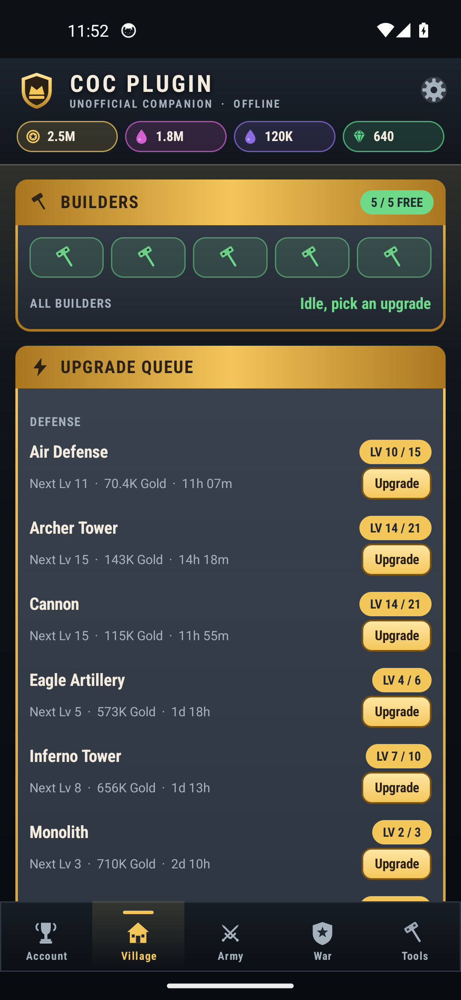
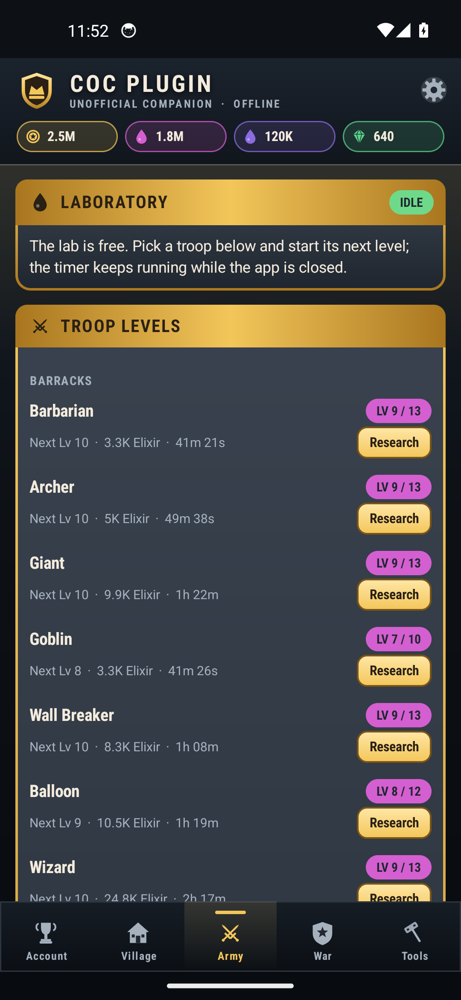
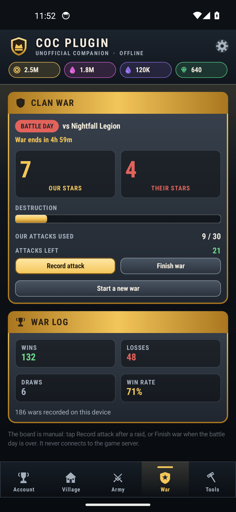

# COCPlugin

**An unofficial, offline Clash of Clans themed companion for Android.**
Package `plugin.clashofclans`, app name *COCPlugin*.

COCPlugin is a planner and dashboard for the numbers a chief checks every day:
account status, league progress, the builder queue, laboratory research, the
current clan war and a small loot calculator. It is drawn from scratch in a
warm gold-on-stone style that matches the look of the game world.

It is **not** a mod, a private server client or a bot. It has no network
permission, cannot read the game, and ships no artwork, font or sprite of the
game. All icons and backgrounds are original vector and canvas drawings.

> Clash of Clans is a trademark of Supercell. This project is not affiliated
> with, endorsed by or connected to Supercell.

## Screens

| Tab | What it does |
| --- | --- |
| **Account** | Player name and tag, Town Hall and experience level, XP bar, trophy league with the next bracket, career stats, donation ratio, war win rate, clan card. The profile is editable and stored locally. |
| **Village** | Sixteen buildings with their level, next-level cost and build time. Five builder slots, a live countdown and progress bar per upgrade, a builder queue, and gold / total build time to max. |
| **Army** | The laboratory queue and twenty-two troops. Research costs and times, a live lab countdown, and a progress meter of the whole research ladder. |
| **War** | Current war state, opponent, live countdown, stars for both sides, attacks used and left, a star recorder, and a war log with W/L/D and win rate. |
| **Tools** | Season reset clock (first of the month, 05:00 UTC), a loot calculator that can bank the result into the local resources, and the upgrade planner totals. |

Plus a settings sheet with three crown accents (Royal Gold, Dark Elixir, Ice
Crown), a profile reset, and the version / disclaimer.

Upgrade and research timers are persisted as absolute end times, so they keep
running while the app is closed and settle the next time the app opens.

## Design

The whole UI is built from the Android framework: no AndroidX, no Material
library, no third-party runtime dependency. That keeps the APK at roughly
60 KB and makes the build reproducible without network access.

| Layer | Path |
| --- | --- |
| Model and maths (pure Java, unit-tested on the JVM) | `app/src/plugin/clashofclans/model` |
| Local profile and timer store (`SharedPreferences`) | `app/src/plugin/clashofclans/data/Store.java` |
| Theme, drawables, canvas icons, widgets | `app/src/plugin/clashofclans/ui` |
| Themed screens | `AccountPanel`, `VillagePanel`, `ArmyPanel`, `WarPanel`, `ToolsPanel` |
| Single activity shell and the five tabs | `MainActivity.java` |

The palette, gold rims, header ribbons, beveled buttons, medallions and the
icon set are generated at runtime (`Skin`, `GlyphView`) or described in
`res/drawable` / `res/mipmap-anydpi-v26`. The launcher icon is an original
shield-and-crown vector.

## Build

Requirements: JDK 17 (or newer), Android SDK with build-tools and a platform
(`android-34` or newer). No Gradle, no network.

```bash
export ANDROID_HOME=/path/to/android-sdk
bash build.sh
```

The script runs the unit tests, compiles the resources with `aapt2`, compiles
the Java sources, dexes with `d8`, aligns with `zipalign`, signs with
`apksigner`, verifies the package name, and writes:

```
dist/COCPlugin-1.0.0.apk
dist/COCPlugin-1.0.0.sha256
```

Override the version with `VERSION` and `VERSION_CODE`.

The release key is the committed self-signed keystore
`keystore/coc-plugin.jks` (alias `cocplugin`, password `cocplugin`) so updates
install over each other. Override it with `COC_KEYSTORE`,
`COC_KEYSTORE_PASSWORD`, `COC_KEY_ALIAS` and `COC_KEY_PASSWORD`.

Install on a device or emulator:

```bash
adb install -r dist/COCPlugin-1.0.0.apk
adb shell am start -n plugin.clashofclans/.MainActivity
```

## Tests

```bash
bash tests/run.sh
```

runs 429 assertions over the pure model: tag normalisation, the XP curve,
duration and number formatting, upgrade cost growth, catalogue integrity,
league thresholds and progress, loot and raid maths, war result rules and the
season clock.

`docs/ACCEPTANCE.md` records the device/API matrix and the smoke run that goes
with a release.

## Screens

| Account | Village | Army | War | Tools |
| --- | --- | --- | --- | --- |
|  |  |  |  |  |

Recorded on Android 14 (API 34). See `docs/ACCEPTANCE.md` for the matrix.

## Layout of the repository

```
app/                 manifest, Java sources, resources
tests/               plain-JVM regression suite
keystore/            the self-signed release key
docs/                acceptance record and screenshots
.github/workflows/   CI: build, test and verify on every push
build.sh             the whole build in one script
```

## Licence

MIT for everything in this repository. No game assets are included or
redistributed.
